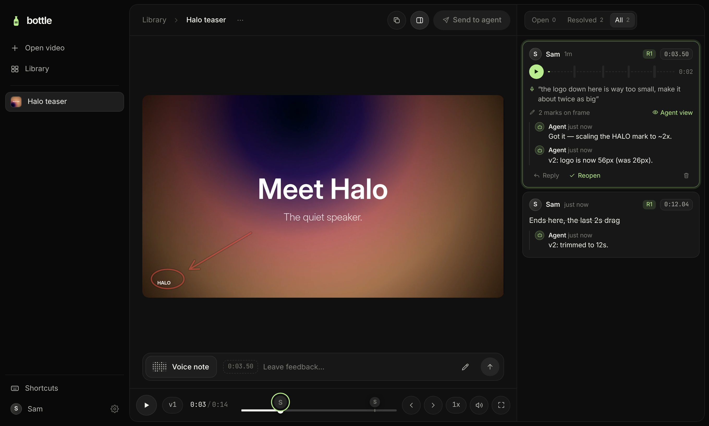
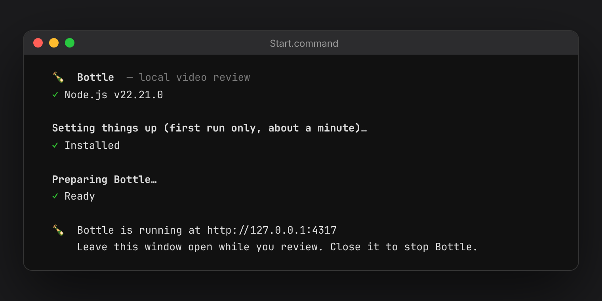
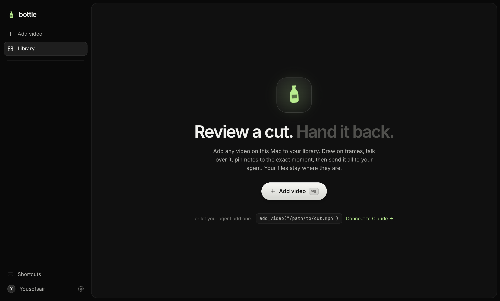
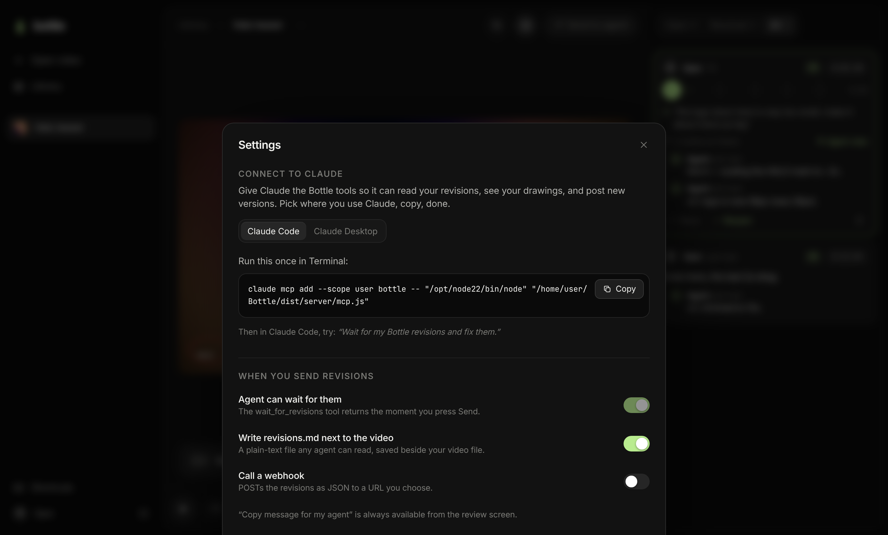

<p align="center"></p>

# 🍾 Bottle

**Review a video. Hand the notes to your AI agent.**

Bottle is a video review app that runs on your own Mac. You watch a cut that an AI agent or an editor made, then
draw on frames, pin comments to exact moments, and talk through voice notes. When you press **Send to agent**, your
agent (for example Claude) reads every note, sees exactly what you circled, and makes the next version.

Nothing is uploaded. Bottle plays your video straight from where it sits on your disk.

---

## Get started in 3 steps

### 1. Download Bottle
Click the green **Code** button on this page, then **Download ZIP**. Open the zip file. You'll get a `Bottle` folder,
which you can put anywhere you like (Documents works).

### 2. Double-click `Start.command`


- **The first time**, macOS may say it's from an unidentified developer. **Right-click** `Start.command`, choose
  **Open**, then click **Open** again. You only need to do this once.
- If you don't have Node.js yet, Bottle offers to install it for you. Click **Install Node.js** and click
  **Continue** through the standard installer.
- The first start takes about a minute while it sets up. After that it's instant.

Your browser opens Bottle. Keep the small Terminal window open while you review, and close it when you're done.

### 3. Click **Open video**


Pick any video in the Mac file picker and you're reviewing. That's it.

---

## Reviewing

| Do this | How |
|---|---|
| Play / pause | <kbd>Space</kbd> (or <kbd>J</kbd> <kbd>K</kbd> <kbd>L</kbd> to shuttle) |
| Step one frame | <kbd>←</kbd> <kbd>→</kbd> |
| Comment at this moment | <kbd>C</kbd>, or click just above the timeline |
| Draw on the frame | <kbd>D</kbd>, then <kbd>1</kbd>–<kbd>4</kbd> for pen, arrow, box, circle |
| Voice note | <kbd>R</kbd> to start, <kbd>R</kbd> to stop. A transcript is saved too, since agents can't hear audio |
| Post the comment | <kbd>Enter</kbd> |
| Send everything to your agent | **Send to agent** (<kbd>⌘</kbd><kbd>↩</kbd>) |
| See every shortcut | <kbd>?</kbd> |

- **Versions:** when your agent saves a new cut (for example `promo_v2.mp4`), Bottle adds it as **v2** of the same
  video. Switch versions from the `v2` chip next to the play button. Each version keeps its own comments.
- **Rounds:** comments stay "Unsent" until you press **Send to agent**. Then they go out together as one round.
- **Your files are safe:** Bottle never copies, moves, changes or re-encodes a video. "Remove from Bottle" only
  removes it from the list.

## Connect your agent

Open **Settings** (bottom-left) → **Connect to Claude**. Bottle shows the exact snippet with your paths filled in:

- **Claude Code:** copy the one-line command and run it once in Terminal.
- **Claude Desktop:** paste the JSON into the config file it names, then restart Claude Desktop.



Then ask your agent something like *"Wait for my Bottle revisions on the promo video and fix them."*

When you send a round, your agent can hear about it in up to four ways, set in **Settings**:

1. **`wait_for_revisions`**: the agent waits and wakes up the moment you press Send.
2. **`revisions.md`**: a plain-text summary is written next to your video file.
3. **Webhook**: Bottle POSTs the revisions as JSON to a URL you choose.
4. **Copy message for my agent**: the copy button at the top of the review screen gives you a ready-to-paste message.

### Tools your agent gets (MCP)

| Tool | What it does |
|---|---|
| `add_video(path, title?)` | Add a video by its path. A matching name or path becomes the next version. |
| `list_videos()` | Every video, with its latest version, file path and number of open revisions. |
| `get_revisions(video_id, status="open")` | Structured JSON: timestamp, timecode, frame, text, voice transcript, a plain-words description of any drawing, author, status, replies. |
| `get_frame(video_id, timestamp)` | The frame as an image **with your drawing burned in**, so the agent sees exactly what you circled. Pass `revision_id` to get that note's own frame. |
| `reply_to_revision(id, text)` | Reply in the thread. It shows up live in your browser. |
| `resolve_revision(id, note?)` | Mark it done, with an optional note. |
| `wait_for_revisions(video_id, timeout)` | Waits until you press **Send to agent**, then returns that round. |

<p align="center"></p>

---

## For the curious

- **Private by design.** The server only listens on `127.0.0.1`, so other devices can't reach it, and it rejects
  requests for any other hostname. Your notes live in `data/` inside this folder: a SQLite database plus your voice
  notes.
- **Instant seeking, even on huge files.** Video is streamed with HTTP Range requests straight from its original
  location. Each seek reads only the bytes it needs.
- **Live transcription** uses your browser's speech engine. In Chrome that may send audio to Google to transcribe
  it. For a fully offline setup, choose **whisper.cpp** in Settings (`brew install whisper-cpp` plus a model file).
- **ffmpeg** comes bundled (`ffmpeg-static`). It's only used to read video info, make poster frames, and render
  frames for `get_frame`.
- **Windows/Linux:** everything that depends on the operating system lives in `server/platform/`. The Windows file
  picker is scaffolded but untested. On Linux without `zenity`, Bottle asks you to paste a file path instead.

### Developing

```bash
npm install
npm run dev        # API on :4317 + Vite on :5173 with hot reload
npm run build      # builds web + server into dist/
npm run mcp        # run the MCP server on stdio
node scripts/mcp-smoke.mjs   # call every MCP tool once
```

Architecture notes: [`docs/ARCHITECTURE.md`](docs/ARCHITECTURE.md) · UX study: [`docs/UX-NOTES.md`](docs/UX-NOTES.md)
